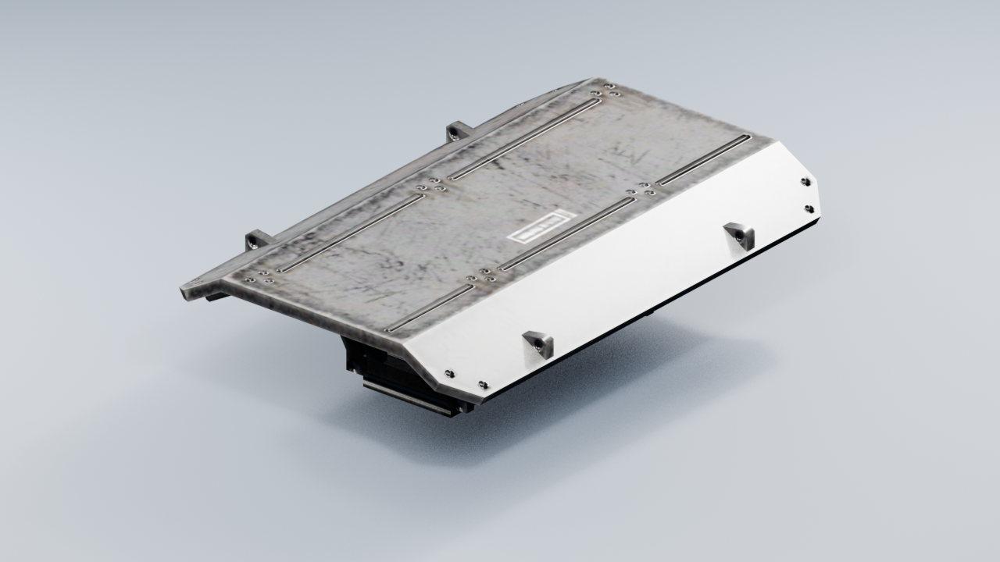
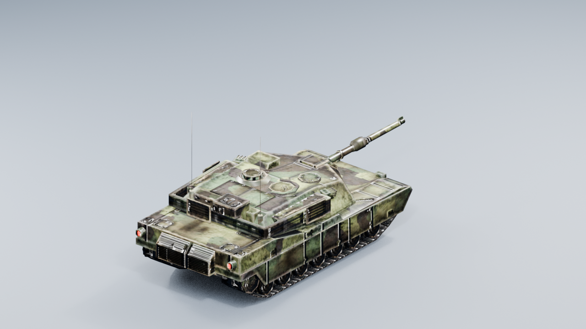
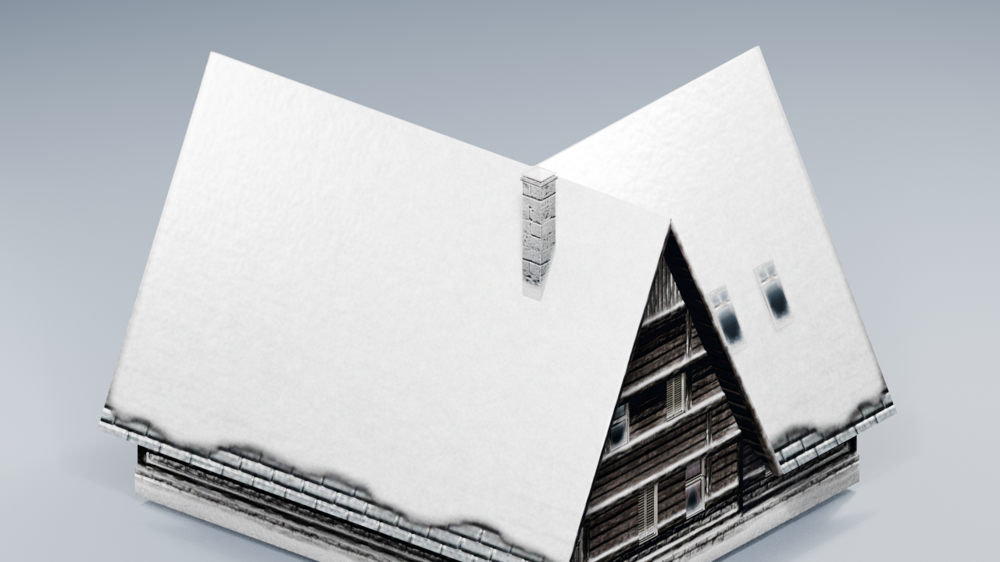
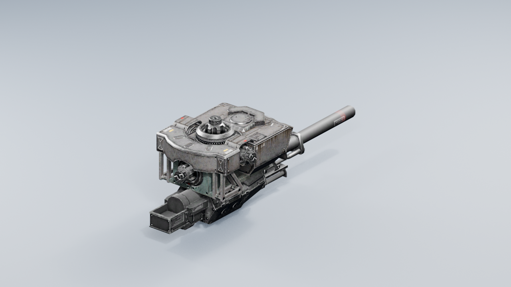
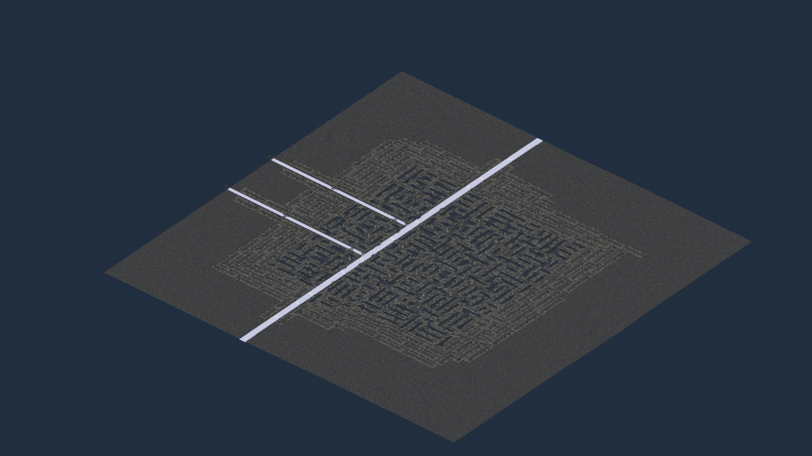

# Chromehounds Importer for Blender 5.2

Chromehounds Importer is a Blender 5.2 extension for importing retail
Chromehounds assets directly from either an extracted game directory or an
XGD2/XDVDFS ISO.

The importer supports:

- HOUND parts and other BND3 model bundles
- MDL4 render meshes, SMD4 shadow meshes, bones, weights, dummies, and LODs
- M2A 0x300/0x301 animation clips as Blender 5.2 layered Actions
- XPR2/XPC textures, including Xbox 360 tiling, endian conversion, swizzles,
  cube faces, and the retail compressed formats
- Principled BSDF materials with direct, internally packed Blender images
- Individual props and characters
- MSB levels with selectable linked map pieces, props, and characters
- User-authored `.chbuild.json` assemblies for combining HOUND parts

No intermediate DDS, PNG, FBX, or extracted ISO tree is required. Vertex,
texture-address, and block-decompression work uses NumPy. Decoded pixels are
sent directly to Blender with `Image.pixels.foreach_set` and packed internally
so they remain available when the `.blend` file is reopened.

## Example imports

| HOUND part imported directly from the retail ISO | Animated character with imported M2A Actions |
|---|---|
|  |  |

| Textured map prop | Two-part HOUND socket assembly |
|---|---|
|  |  |

**Complete `m01_001` level with 8,378 selectable placements**



## Install

1. Build the extension:

   ```powershell
   & "D:\Blender Foundation\Blender 5.2\blender.exe" `
     --command extension build `
     --source-dir ".\chromehounds_importer"
   ```

2. In Blender 5.2, open **Edit > Preferences > Get Extensions**.
3. Use the menu in the upper-right, choose **Install from Disk**, and select
   the generated `chromehounds_importer-0.1.0.zip`.
4. Enable **Chromehounds Importer** if Blender does not enable it
   automatically.

For development, the `chromehounds_importer` directory can also be installed
as an editable extension directory.

## Import a local asset

Use **File > Import > Chromehounds Asset** or drag a supported file into the
3D View.

Useful retail examples:

| Asset | Example |
|---|---|
| HOUND part | `parts\AX_AM001.bnd` |
| Character and animations | `chr\c0101.bnd` |
| Prop | `mapdata\obj\o01-000\o01-000.bnd` |
| Level | `mapdata\map\m01_001\m01_001.msb` |
| Texture package | `mapdata\tex\m01.xpr` |

When an asset is under an extracted game directory, the importer detects that
root automatically. This lets MSB imports resolve external object and
character bundles.

## Import directly from the ISO

Open the **Chromehounds** tab in the 3D View sidebar:

1. Set **Game Source** to the retail ISO path or an extracted `game` folder.
2. Set **Asset Path** to its virtual game path, such as
   `parts/AX_AM001.bnd`.
3. Choose **Import from Game Source**.

The ISO reader indexes XDVDFS and reads only the selected assets and their
companions. It does not extract the disc.

For a level, use an MSB virtual path such as
`mapdata/map/m01_001/m01_001.msb`. The importer loads the adjacent map BND,
the appropriate `mapdata/tex/mNN.xpr`, and referenced prop or character BNDs.

## Options

- **Unit Scale**: Blender units per game unit. The default `0.01` treats game
  units as centimeters.
- **Animation FPS**: Scene frame rate assigned when M2A Actions are imported.
  The default is the game's 30 FPS.
- **Import LODs**: Imports `_L01`, `_L02`, and similar model entries. Imported
  LOD collections start hidden.
- **Import Shadow Meshes**: Imports SMD4 meshes as non-rendering wire objects.
- **Import Animations**: Converts embedded M2A clips to Blender Actions.
- **Import Textures**: Decodes referenced textures directly into generated,
  internally packed Blender images. No external image files are required when
  the `.blend` is moved or reopened.
- **Resolve Map Props**: Loads external objects and characters used by an MSB.
- **Create Armatures**: Creates edit bones, vertex groups, and Armature
  modifiers. Disable this for lightweight static imports.
- **Map Placements**: **Selectable Linked Objects** creates directly
  selectable level meshes while sharing mesh and material datablocks between
  repeated models. Use Blender's **Make Single User** command before changing
  only one placement. **Collection Instances** retains the lower-object-count
  legacy mode for large previews, but its placement empties do not expose
  material slots directly.
- **Map Instance Limit**: Imports at most this many placements. Zero imports
  the complete level. This is useful when previewing levels containing
  thousands of objects.

## HOUND build manifests

Native Chromehounds garage/save assembly data is not currently decoded.
Complete builds can instead be described with a small importer-owned JSON
format whose file name ends in `.chbuild.json`.

An editable example is provided at
[`examples/example.chbuild.json`](./examples/example.chbuild.json), with a
JSON Schema at
[`chromehounds_importer/chbuild.schema.json`](./chromehounds_importer/chbuild.schema.json).

```json
{
  "version": 1,
  "name": "Example HOUND",
  "source": "E:\\Git\\Chromehounds\\game",
  "parts": [
    {
      "id": "base",
      "asset": "parts/CK_CA001.bnd"
    },
    {
      "id": "child",
      "asset": "parts/WP_GN001.bnd",
      "parent": "base",
      "socket": 200,
      "location": [0.0, 0.0, 0.0],
      "rotation_degrees": [0.0, 0.0, 0.0],
      "scale": [1.0, 1.0, 1.0]
    }
  ]
}
```

`source` may name an extracted game directory or ISO. It can be omitted when
the Blender sidebar already has a game source or when the manifest is within
the extracted game tree.

Each part supports:

- `id`: Unique assembly ID. If omitted, `part_NNN` is used.
- `asset`: Virtual BND path in the selected game source.
- `model`: Optional MDL stem when a bundle contains multiple non-LOD models.
- `parent`: Optional parent part ID.
- `socket`: Optional dummy object name or numeric dummy reference ID on the
  parent.
- `matrix`: Optional Blender-space row-major 4x4 local matrix.
- `location`, `rotation_degrees`, `scale`: Blender-space local transform used
  when `matrix` is absent.

Transforms on parented parts are local to the selected socket or parent root.
Unparented part transforms are world-space. Parts remain separate Blender
collections and objects.

## Coordinates and data mapping

- Game positions map to Blender as `(x, -z, y)`.
- Node Euler values use the source XZY order.
- MSB placement rotations are interpreted as degree-valued XYZ transforms.
- Triangle strips are expanded with restart markers and alternating winding.
- Rigid and weighted MDL vertices are moved into model bind space before
  Blender Armature modifiers are applied.
- Diffuse color/texture, normal texture, and specular power are mapped to
  Principled BSDF nodes. Standard alpha blending uses smooth Blender blending,
  alpha-reference materials use binary cutouts, and game blend mode 3 light
  overlays use transparent-plus-emission additive nodes instead of making the
  underlying level surface alpha-dithered. Opaque mesh objects keep Blender's
  viewport transparency, transparent-shadow, and transparency-overlap flags
  disabled.
- Level materials are imported double-sided so one-sided game geometry does
  not appear transparent when viewed from its back side in Blender.
- Matching `_c` paint/customization textures are exposed as labeled image
  nodes without guessing the game's runtime paint-compositing formula.
- CTX1 and DXN/BC5 normal maps have their blue channel reconstructed.
- Cube resources are imported as six generated images.

## Verified retail format coverage

The implementation was audited against the supplied USA/Europe retail asset
tree:

- 1,788 BND archives, including E0, E4, and F0 variants
- 15,165 embedded MDL4 models
- 11,051 embedded SMD4 models
- 881 embedded M2A animations
- 2,991 standalone XPR/XPC packages containing 4,750 textures
- 795 embedded XPR2 packages containing another 1,853 textures
- 86 MSB levels containing 18,260 model definitions and 276,392 placements
- All 1,147 unique external prop/character bundles referenced by those levels
- Both 40-byte and 52-byte retail XPR texture descriptors
- BC1, BC2, BC3, BC4, BC5/DXN, CTX1, DXT3A, RGBA8, and ARGB1555 retail
  texture resources

## Current limitations

- Native garage/save build records have not been reverse-engineered; use
  `.chbuild.json` for complete assemblies.
- M2A key translation, rotation, and scale are imported, but the four
  proprietary interpolation-control references are not fully understood.
  Blender uses its normal Bezier interpolation between decoded keys.
- Chromehounds shaders are approximated with Principled BSDF nodes. Game-only
  effects, paint compositing, parallax behavior, and render-state details are
  not reproduced exactly.
- MSB placement rotation order is based on the retail data and current visual
  research but has not been proven from game code.
- Collision/HM2, navigation/NVM, particles, audio, scripts, and gameplay
  entities are outside the current scene-import scope.
- Blender does not have a native Xbox cube-map image type, so cube faces are
  exposed as six images rather than one GPU cube resource.

## Development and validation

Run the standalone parser tests:

```powershell
$env:CHROMEHOUNDS_GAME_ROOT = "E:\Git\Chromehounds\game"
$env:CHROMEHOUNDS_ISO = "F:\path\to\Chromehounds.iso"
python -m unittest discover -s tests -p "test_*.py" -v
```

Run the Blender 5.2 smoke suite:

```powershell
$env:CHROMEHOUNDS_GAME_ROOT = "E:\Git\Chromehounds\game"
& "D:\Blender Foundation\Blender 5.2\blender.exe" `
  --background --factory-startup --python tests\blender_smoke.py
```

The smoke suite imports a textured HOUND part, a 23-bone animated character,
100 selectable linked placements from a retail MSB level, and one legacy
collection-instance placement.

## License and research

The extension is MIT licensed. See
[`THIRD_PARTY_NOTICES.md`](./THIRD_PARTY_NOTICES.md) for the MIT-licensed
format and GPU-decoding research used to implement it.
